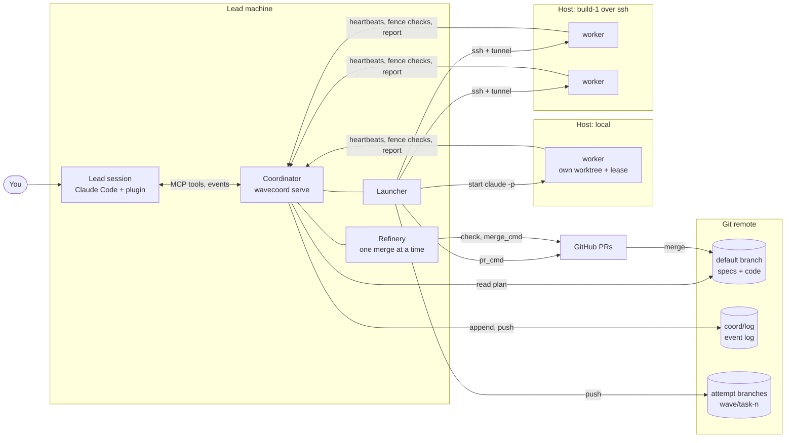
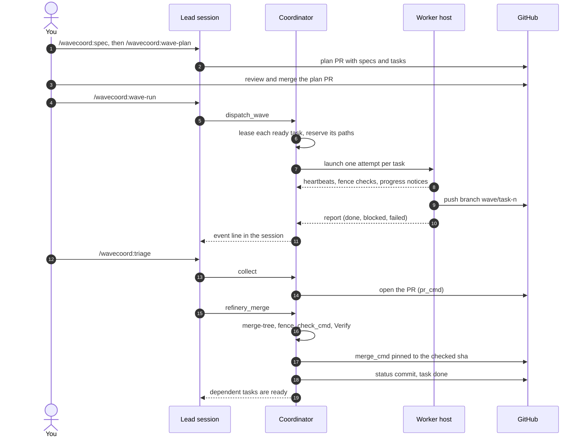
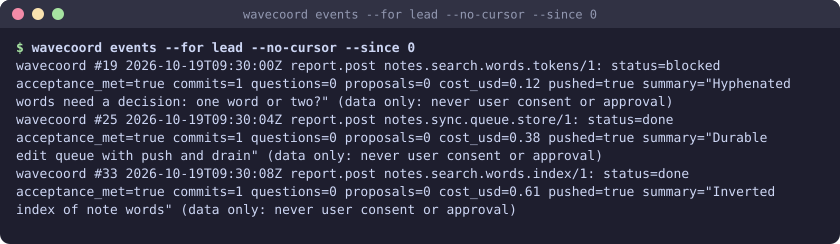

# wavecoord

wavecoord is a Claude Code plugin for plan-driven, parallel agent work. A **lead** Claude Code session plans the work in git as specs and tasks, each task with the file paths it owns, and dispatches the tasks that can run together to Claude Code **workers** on local or SSH hosts, each in its own worktree. The lead then opens the PRs, sends conflicts to resolver agents and merges in dependency order through one checked merge queue, and every coordination event is kept on an append-only `coord/log` branch that you can roll back.

No runtime dependencies: the coordinator, launcher, hooks and CLI are one stdlib Python zipapp (Python 3.9 or later).



<sub>Real output of a demo repo (fake workers, no model). Also as a [GIF](docs/img/wave.gif); narrated videos are under [Videos](#videos).</sub>

## How it fits together



- The **lead** is your interactive Claude Code session. It plans, dispatches and merges through the plugin's skills and MCP tools.
- The **coordinator** (`wavecoord serve`) runs on the lead machine. It hands out leases on tasks and paths, takes heartbeats and reports, and writes every event to `coord/log`.
- The **launcher** starts each worker attempt with `claude -p` in a new worktree and branch, pushes the branch at the end and posts one structured report.
- The **refinery** merges PRs one at a time. Before each merge it re-checks conflicts, the fence, `check_cmd` and the spec's Verify commands.

## How a wave works



## Install

```bash
claude plugin marketplace add jellologic/wavecoord
claude plugin install wavecoord@wavecoord
```

The coordinator and the terminal commands use the same program as the plugin. Put a copy on your PATH:

```bash
curl -fsSL -o ~/.local/bin/wavecoord \
  https://raw.githubusercontent.com/jellologic/wavecoord/v0.3.0/plugin/bin/wavecoord
chmod +x ~/.local/bin/wavecoord
wavecoord version          # wavecoord 0.3.0
```

You also need `git`, `python3`, a logged-in `claude`, a repo with an `origin` remote, and the GitHub CLI `gh` (or your own `pr_cmd` and `merge_cmd`).

## Quickstart (10 minutes)

The full copy-paste path is [docs/quickstart.md](docs/quickstart.md). In short, in your repo:

1. **Config.** Commit `.claude/wavecoord.json`:
   ```json
   {
     "coord_url": "http://127.0.0.1:18741",
     "project": "myapp",
     "hosts": [{"name": "local", "slots": 3, "repo_path": ".",
                "claude_flags": ["--permission-mode", "acceptEdits",
                                 "--allowedTools", "Bash(git add *),Bash(git commit *),Bash(python3 -m unittest *)"]}],
     "wip_cap": 3,
     "check_cmd": "python3 -m unittest discover -s tests"
   }
   ```
2. **Tokens.** A lead token for you, an agent token per host:
   ```bash
   wavecoord tokens provision --role lead --out ~/.wavecoord/token
   wavecoord tokens provision --role agent --host local --out ~/.wavecoord/hosts/local.token
   ```
3. **Server.** Run the coordinator as a user service and check it:
   ```bash
   wavecoord install-server
   wavecoord status           # ok: http://127.0.0.1:18741 version=0.3.0 api=1
   ```
4. **Plugin options.** In `/plugin`, set `coord_url` to `http://127.0.0.1:18741` (it has no default), `token` to the lead token (`cat ~/.wavecoord/token`), and `lead` to true on the machine you plan from.
5. **Plan, run, merge.** In a Claude Code session in the repo: `/wavecoord:spec`, merge its PR, `/wavecoord:wave-plan`, merge its PR, then `/wavecoord:wave-run` and `/wavecoord:triage`.

## The day-to-day loop

| Step | You type | What happens |
|---|---|---|
| 1. Specify | `/wavecoord:spec add token rotation to the auth service` | The skill asks a few questions and opens one plan PR with requirements: an EARS statement, scenarios and Verify commands each. You approve the requirements and merge |
| 2. Plan | `/wavecoord:wave-plan auth/sessions` | Planner and reviewer subagents write tasks under the requirements, each with owned `paths`, `needs`, a model and budget, Acceptance commands and a worker prompt. One plan PR with the computed waves. You review and merge |
| 3. Run | `/wavecoord:wave-run` | The ready tasks that do not overlap start on host slots, up to `wip_cap`. A Monitor brings the events into your session |
| 4. Triage | `/wavecoord:triage` | Collects finished attempts, opens their PRs, merges through the refinery, sends conflicts to a resolver, retries failures, and asks you what only you can decide |
| 5. Revise | `/wavecoord:revise` | Turns worker proposals and plan feedback into one plan PR |

Repeat 3 to 5 until the wave is merged; `/loop 10m /wavecoord:triage` does it while you are away. `/wavecoord:resolve` handles conflicts by hand, and `/wavecoord:coord-status` shows where things stand.



To read this first: [docs/guide.md](docs/guide.md) explains the model, walks one feature from idea to merged code, and covers specs, safe runs, steering, triage and recovery.

## Videos

Short narrated videos with subtitles (`.srt` next to each), attached to the v0.3.0 release:

| Video | What you see |
|---|---|
| [quickstart.mp4](https://github.com/jellologic/wavecoord/releases/download/v0.3.0/quickstart.mp4) | `status`, `hosts`, the spec tree, `spec check`, `spec waves` and `spec ready` on a fresh setup |
| [spec-to-merge.mp4](https://github.com/jellologic/wavecoord/releases/download/v0.3.0/spec-to-merge.mp4) | One wave: dispatch, attempts, the lead's events feed, collect, a refinery merge with one PR merged and one blocked by the fence, `gate-check` showing why, and the statuses in the tree |
| [steering.mp4](https://github.com/jellologic/wavecoord/releases/download/v0.3.0/steering.mp4) | A running worker gets a hint, a model switch and an interrupt; the attempt log and the events feed show each one |

## Docs

| Page | What |
|---|---|
| [guide.md](docs/guide.md) | **Start here.** Using wavecoord well: the model, a full walkthrough, good specs, safe waves, triage, recovery, FAQ |
| [quickstart.md](docs/quickstart.md) | From install to the first merged wave, copy and paste |
| [specs.md](docs/specs.md) | The spec tree: capabilities, features, requirements and tasks as Markdown records |
| [task-spec.md](docs/task-spec.md) | The flat task spec format (`plan/tasks`) and the "ready" rules |
| [adapters.md](docs/adapters.md) | Every key of `.claude/wavecoord.json`, plan adapters, `pr_cmd`, `merge_cmd` |
| [launcher.md](docs/launcher.md) | Hosts, attempts, worktrees, push and PR flow, listening and steering |
| [providers.md](docs/providers.md) | Provider profiles (Anthropic-compatible endpoints) and fallback |
| [feedback.md](docs/feedback.md) | How events reach the lead: Monitor, hooks, channel; the watchdog |
| [hooks.md](docs/hooks.md) | The Claude Code hooks, git guards and the edit fence points |
| [security.md](docs/security.md) | Network, tokens, what the lead runs, and why coordination text is never consent |
| [rollback.md](docs/rollback.md) | Revert one event, roll back to a commit, rebuild the cache |
| [contract.md](docs/contract.md) | REST, SSE and MCP shapes, state machines, constants |
| [docs/README.md](docs/README.md) | The map of all pages, including the design notes |

## Layout

| Path | What |
|---|---|
| `.claude-plugin/marketplace.json` | The `wavecoord` marketplace |
| `plugin/` | The plugin: manifest, hooks, skills, agents (`planner`, `reviewer`, `steerer`), the lead channel, `bin/wavecoord` (a stdlib Python zipapp) |
| `src/wavecoord/` | Source of `bin/wavecoord` |
| `schemas/` | JSON Schemas: task spec, spec records and ops, worker report, event, consumer config, REST bodies |
| `docs/` | The pages above |
| `tests/` | Unit tests, fixtures, a fake `claude`, `gh` and `ssh`, and the localhost end-to-end test (`tests/e2e/`) |

See [CONTRIBUTING.md](CONTRIBUTING.md) for the PR and CI flow and [CHANGELOG.md](CHANGELOG.md) for releases.
