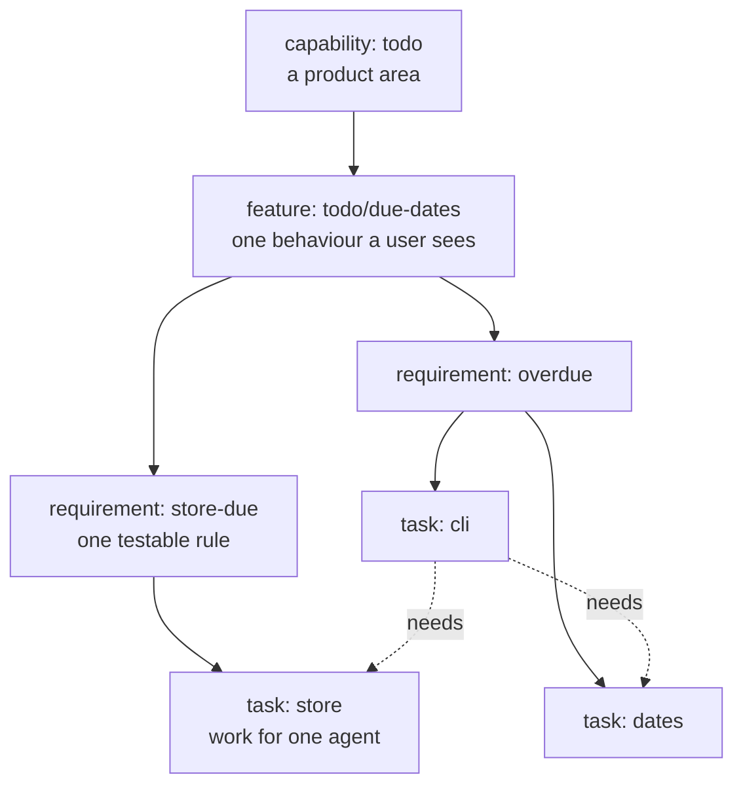
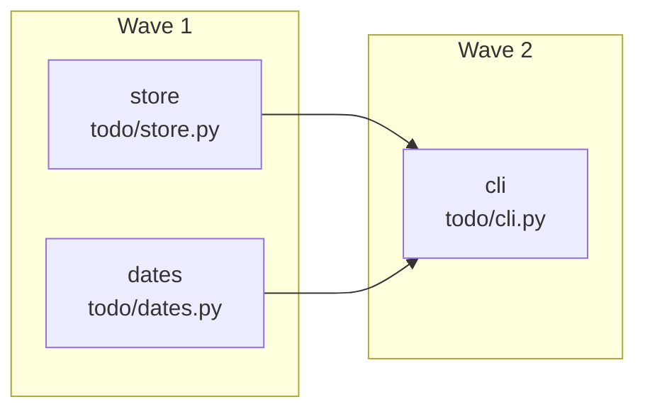
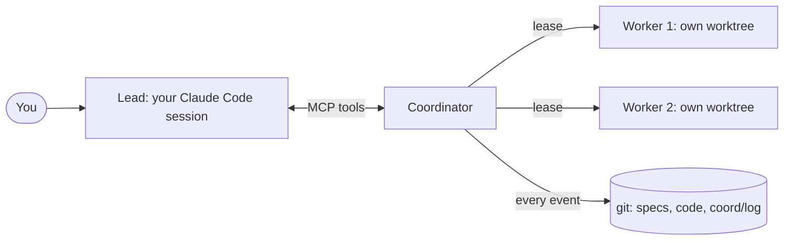

# Lesson 0: What SDD is, and how wavecoord does it

**Video:** [course-00-what-is-sdd.mp4](https://github.com/jellologic/wavecoord/releases/download/v0.3.0/course-00-what-is-sdd.mp4) (about 4 minutes, no code)

## Goals

- Know the problem that spec-driven development (SDD) solves.
- Know the four kinds of records in a wavecoord spec tree: capability, feature, requirement, task.
- Read an EARS statement and a Verify command.
- Know what a wave, the lead and a worker are, and why everything is in git.

## Why it matters

With one agent and a chat, you steer as you go: you read each answer and correct it. That stops working when several agents work at once, or when nobody watches. Each agent fills the gaps in your request with guesses. Two of them edit the same file. And nobody can say when the work is "done".

This is measurable. In a 2026 benchmark of coding agents ([Orchid](https://arxiv.org/html/2604.21505v1)), ambiguous task statements lowered the pass rate of every model tested, by about 7 points on average. Structured requirements that are checked by tests did better. What the evidence does not show is that a heavy process helps: long spec documents, double reviews and agents that ignore the spec are common complaints. So the goal is small, clear and checkable specs, with the checks run by a machine, not by the agent that did the work.

## The ideas

### Specs are the source of truth

You write down what must be true before any code is written. The spec lives in git, next to the code, and it changes only through a pull request that you review. Agents build from the spec, and checks prove the result against it. You specify the next feature, not the whole product.

### The spec tree

Each node is one Markdown file under `specs/`, and its path is its id: `todo/due-dates/store-due/store`. A task says which files it may change (`paths`), what it needs first (`needs`), which model and budget it gets (`exec`), how to check it (Acceptance) and what to tell the worker (Prompt).

### EARS: one testable sentence

A requirement's statement is one sentence with `shall` exactly once, in one of a few patterns (Easy Approach to Requirements Syntax):

| Pattern | Example |
|---|---|
| The `<system>` shall `<response>`. | The store shall keep each item until it is deleted. |
| When `<trigger>`, the `<system>` shall `<response>`. | When an item is added with a due date, the to-do store shall save the due date with the item. |
| While `<state>`, the `<system>` shall `<response>`. | While the file is read-only, the CLI shall refuse to add items. |
| If `<condition>`, then the `<system>` shall `<response>`. | If the due date is not YYYY-MM-DD, then the CLI shall exit with status 2. |
| Where `<feature>`, the `<system>` shall `<response>`. | Where colors are on, the CLI shall print overdue items in red. |

One behaviour, and a response you can measure. "Fast" and "friendly" are not testable.

### Scenarios and Verify

Each requirement also has scenarios (Given, When, Then: the main path and the failure path) and **Verify** commands. A Verify command fails today and passes only when the work is done, for example `python3 -m unittest tests.test_due_store`. wavecoord runs it again on the merge result before it merges, so an agent never grades its own work.

### Waves

You never write the schedule. Two tasks can run at the same time when neither needs the other and their `paths` do not overlap. `wavecoord spec waves` groups the tasks into waves: wave 1 is what can start now.

### The lead and its workers

- The **lead** is your interactive Claude Code session with the plugin. It plans, starts workers and merges. It does not write feature code.
- A **worker** is another Claude Code (`claude -p`) that runs one task alone, in its own git worktree and branch, with a **lease** on the task's paths.
- The **coordinator** (`wavecoord serve`) hands out the leases, takes the workers' reports, and records every event.

### Why git

The plan is files on your default branch, reviewed like code. Every coordination event is a commit on the `coord/log` branch. So you can see what happened (`wavecoord log`) and undo it: revert a plan PR, revert one event, or roll the log back (lesson 10).

### Other SDD tools

| Tool | What it does well |
|---|---|
| GitHub Spec Kit | A project constitution, then `specify`, `plan`, `tasks` and `implement` per feature, with stable ids and `[P]` markers for parallel tasks |
| Amazon Kiro | Requirements in EARS form, a design and tasks per spec, run in waves inside the IDE |
| OpenSpec | Living specs per capability, plus change folders with deltas that are merged in when done |

All three write the spec before the code. wavecoord's focus is the next step: running many workers safely in parallel, with leases on files, one merge queue and checks it runs itself. If you use one of them, lesson 5 imports your files.

## Steps

The video ends with a short look at Claude Code: type `/wavecoord:` in a session with the plugin and the command menu lists the skills you will use: `setup`, `spec`, `spec-import`, `wave-plan`, `wave-run`, `triage`, `revise`, `resolve` and `coord-status`.

## Common mistakes

- **Specifying the world.** A spec for every line of existing code is weeks of work and goes stale. Specify the next feature.
- **Vague statements.** "Should be fast and easy" cannot fail a test. Name a value, a status code, a file or an output.
- **Verify that passes today.** It proves nothing. Run it before you approve: it must fail.
- **Letting the agent judge itself.** Put the checks in Verify and Acceptance, where wavecoord runs them at merge.

## Exercise

Take a feature you want to build next in one of your projects. Without any tool, write:

1. One capability and one feature name.
2. Two or three requirements, each one EARS sentence with `shall` once.
3. For each, one Given/When/Then scenario and one command that fails today and will pass when the work is done.

Keep the result: in lesson 2 the `/wavecoord:spec` skill asks you for exactly these things.

Next: [Lesson 1: Install](01-install.md).
