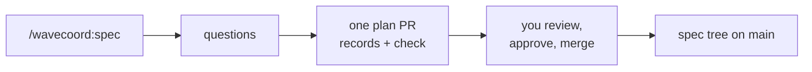

# Lesson 2: Your first spec

**Video:** [course-02-first-spec.mp4](https://github.com/jellologic/wavecoord/releases/download/v0.3.0/course-02-first-spec.mp4) (about 5 minutes)

## Goals

- Specify one small feature with `/wavecoord:spec`.
- Answer the skill's questions so the result is testable.
- Read a requirement record: statement, scenarios, Verify.
- Check that Verify fails today, run `wavecoord spec check`, approve and merge the plan PR.

## Why it matters

The spec decides what "done" means. A worker later gets your requirement word for word, and the merge queue runs your Verify commands before it merges. A vague sentence or a Verify that already passes lets bad work through. This lesson is where you get them right, while they are cheap to change.

## Steps

The demo is the `bookmarks` repo: a README with the idea, the wavecoord config, and nothing else. Your repo works the same way.

### 1. Ask for one feature

```
/wavecoord:spec save and list bookmarks, as the README describes
```

Name one feature, not the whole product. The skill first reads the spec tree, the config and the code (`spec_tree`, `config`, `Glob`, `Read`). If it finds files of Spec Kit, Kiro or OpenSpec, it suggests `/wavecoord:spec-import` instead (lesson 5).

### 2. Say what the skill would ask

Before it writes records, the skill asks what the code cannot tell it. The questions are always about the same four things:

| Question | A good answer |
|---|---|
| Who uses this? | "One person in a terminal." |
| What must be true when it is done? | Commands and their visible results: "`python3 -m bookmarks add <url> --title <t>` saves it in the JSON file; `list` prints them newest first." |
| What is out of scope? | "Find, tags and any web page." It becomes the feature's Non-goals. |
| Which interfaces do others depend on? | "None yet." Name one only if other work builds on it. Never let the agent invent one. |

Put the answers in the same request and it does not need to ask. The video sends this as one message, together with the request from step 1:

```
Users: one person in a terminal. Done when: python3 -m bookmarks add <url> --title <title> saves the
bookmark in the JSON file, and python3 -m bookmarks list prints them, newest first. Out of scope: find,
tags and any web page. No other work depends on an interface yet. When the records are right, you may
set the requirements to approved and the capability and feature to active in this PR.
```

The last sentence is your approval. The skill always asks before it sets a requirement to `approved` or a capability or feature to `active`, because tasks under a draft never run. Saying it up front saves a round trip; you can also wait and answer "yes" when it asks.

### 3. Read what it wrote

What you see: a reviewer subagent checks the records, then the skill opens **one plan PR** and shows its URL, a table of the records (id, kind, status, statement) and the open questions. Read the PR like code:

```
! gh pr view 1
! gh pr diff 1
```

(`!` runs a shell command from Claude Code.) A requirement record looks like this; yours will differ in the details:

```markdown
---
status: approved
kind: requirement
schema: 1
title: Save a bookmark
---

## Statement
When the user runs bookmarks add with a URL and a title, the bookmarks CLI shall save the bookmark in the JSON file.

## Scenarios
### A bookmark is saved
- Given an empty bookmarks file
- When the user runs python3 -m bookmarks add https://example.com --title Example
- Then the file holds one bookmark with that URL and title

### A missing title is refused
- Given an empty bookmarks file
- When the user runs python3 -m bookmarks add https://example.com
- Then the command exits with status 2 and the file is unchanged

## Verify
- `python3 -m unittest tests.test_add`
```

Check each requirement:

- **Statement**: one sentence, `shall` once, one behaviour, a measurable result.
- **Scenarios**: the main path and a failure path, each step something you can observe.
- **Verify**: commands from the repo root, no network or secrets, and they must **fail today**.

### 4. Prove that Verify fails

```
Run the Verify commands of the new requirements here on main, and tell me whether each one fails.
```

What you see: each command fails (the test module does not exist yet). A Verify that passes now would pass at merge too, whatever the worker did.

### 5. Merge and check

```
! gh pr merge 1 --merge && git pull -q
! wavecoord spec check
! wavecoord spec tree
```

`spec check` should report `0 errors`. Its warnings say that no task produces the outputs the requirements promise yet (rules A1 and A3): expected, because tasks come next, with `/wavecoord:wave-plan`. `spec tree` shows the capability, feature and requirements with their status.



## Common mistakes

- **Answering with features instead of results.** "Good search" is not an answer; "`find milk` prints the two bookmarks with milk in the title" is.
- **Approving without reading.** Approval makes the tasks runnable. Read each statement and Verify first.
- **A Verify that runs the whole test suite.** It passes today, so it proves nothing. Name the new test module.
- **Editing records by hand on main.** Change the spec through a plan PR (`/wavecoord:spec` again, or `/wavecoord:revise`), so it is reviewed and checked.

## Exercise

On a practice repo (`python3 scripts/course/demos/demos.py fresh /tmp/wavecoord-demo/bookmarks --port 18741`) or your own:

1. Run `/wavecoord:spec` for one small feature. Answer the four questions in plain words.
2. In the PR, find one statement you can make more precise. Ask the skill to change it before you merge.
3. Prove every Verify fails, then merge and run `wavecoord spec check`.

Next: [Lesson 3: A new project](03-new-project.md), or [Lesson 4: An existing project](04-existing-project.md).
