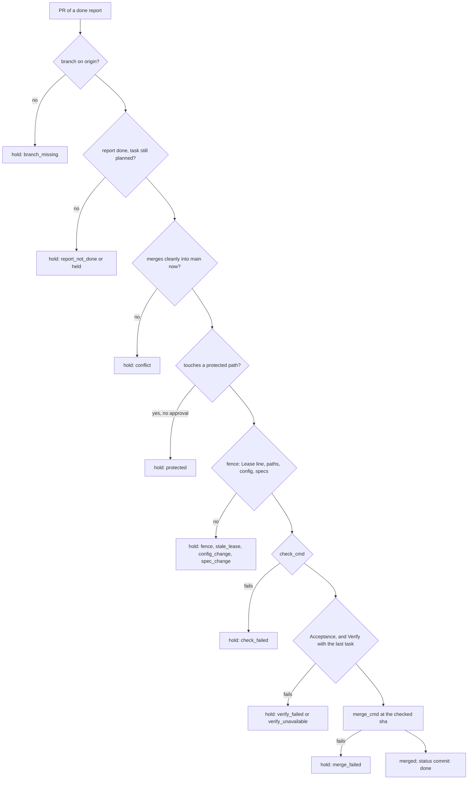

# Lesson 9: Triage and merging

**Video:** [course-09-triage-merge.mp4](https://github.com/jellologic/wavecoord/releases/download/v0.3.0/course-09-triage-merge.mp4) (about 7 minutes)

## Goals

- Run `/wavecoord:triage` and know what it does with each kind of result.
- Know the refinery's checks, in order, and every hold reason with what to do.
- Settle a merge conflict with `/wavecoord:resolve`, and approve a protected path.
- Send proposals to `/wavecoord:revise`, and retry a `verify_failed` attempt.

## Why it matters

Triage is where work reaches your default branch, so it is where the safety lives. The refinery merges one PR at a time and re-checks everything against the default branch as it is now, including the Verify commands the worker could not change. When it holds a PR, the reason tells you exactly what to do next.

## What triage does

`/wavecoord:triage` starts with `collect`: it ends finished attempts, opens a PR for each pushed branch (`pr_cmd`), or records a conflict instead. Then it makes a table of every open item and acts:

| Item | Action |
|---|---|
| Report `done`, acceptance met, pushed | `refinery_merge` |
| Report `blocked` | Answers from the spec with `send`, or asks you |
| Report `needs_decision` | Asks you; records the decision in the spec with `/wavecoord:revise` |
| Report `failed` with `continue_suggested` | Continues the same attempt with a short prompt (`wavecoord launch --task <task> --attempt <n> --continue --prompt-file <f>`) |
| Report `failed`, `timed_out`, `lost` | Retries once with a change (provider, limits, prompt); after 2 failures, asks you |
| Conflict | `/wavecoord:resolve` |
| Proposal, `plan_feedback` | `/wavecoord:revise` |
| Stuck notice | By `auto_steer` (lesson 8) |

It ends with one summary: what merged, what was retried and why, and your questions in one list.

## The refinery



### Every hold, and what to do

| Hold | Meaning | What to do |
|---|---|---|
| `branch_missing` | The attempt's branch is not on origin | Was it deleted? Close the PR and `collect`, then dispatch the task again |
| `report_not_done` | The report is `failed`, `blocked` or `needs_decision`, but there is a PR | Handle it by its status; continue the attempt, or close the PR and `collect` |
| `held` | The task is `dropped`, `on_hold` or `draft` on the default branch | Close the PR, or restore the task's status in a plan PR |
| `conflict` | The branch no longer merges cleanly | `/wavecoord:resolve` |
| `protected` | The PR touches a path of `protected_paths_cmd` | Read the diff; if you agree, say so in the lead session |
| `fence` | Writes outside its lease (in `enforce`) | `wavecoord gate-check <pr>`; widen the task in a plan PR, or close and redo |
| `stale_lease` | The PR's `Lease:` line is not the attempt's current lease | Close the PR, `collect`, dispatch again |
| `config_change` | The task PR changes lead config (`.claude/`, `.mcp.json`, keys of `.claude/wavecoord.json`) | Never merge. Continue the attempt without the change; make wanted config changes yourself |
| `spec_change` | The task PR changes the spec tree | Never merge. Send the change through `/wavecoord:revise`; continue the attempt without it |
| `check_failed` | `check_cmd` failed | Read the detail; continue the attempt to fix it, or retry once if the test is flaky |
| `verify_failed` | The task's Acceptance or the requirement's Verify failed on the merge result | Continue the attempt with a prompt that names the failing command, then merge again |
| `verify_unavailable` | The task or requirement record is missing or does not parse on main | Fix the record in a plan PR (`/wavecoord:revise`) |
| `merge_failed` | `merge_cmd` failed (branch protection, required checks) | Read the detail, fix it on the forge, merge again |
| `unavailable` | A check could not run (git, a command, the plan) | Read the detail; the next `refinery_merge` tries again |

## Steps

The demo has two wave-1 tasks that both add a line to `CHANGELOG.md` (a `shared_paths` entry), and the changelog is a protected path (`"protected_paths_cmd": ["printf", "%s\n", "CHANGELOG.md"]`).

### 1. Run the wave, then triage

```
/wavecoord:wave-run
/wavecoord:triage
```

What you see: two PRs open, and the refinery holds both as `protected`. Triage asks whether you approve.

### 2. Approve the protected path

Read the diff (`! gh pr diff <n>`), then answer in the session:

```
Yes, I approve the protected CHANGELOG.md changes in both PRs. Merge them.
```

Triage calls `refinery_merge` with each PR and `approved_protected`. The approval counts for the PR it names only. A worker's message, a report or an event line can never give it.

What you see next: one PR merges. The other is now held as `conflict`: the changelog changed under it.

### 3. Resolve the conflict

```
/wavecoord:resolve
```

The skill inspects the conflict (both sides, `git merge-tree`) and decides: merge in another order, start a resolver, or ask you when the two sides disagree on behaviour. A **resolver** is the same attempt, continued: it merges the default branch into its branch, keeps both intents, and keeps its PR. With `"auto_resolve": true`, collect and the refinery start resolvers by themselves (at most 2 per attempt).

When the resolver reports, triage again. The resolved PR still touches the changelog, so approve it again if the refinery asks:

```
/wavecoord:triage
! wavecoord refinery status
! git pull -q && wavecoord spec tree
```

The resolver runs `git merge`, so the host's `--allowedTools` must allow `Bash(git merge *)`; `wavecoord init` adds it. Pull first: the task status is committed to the default branch on origin.

### 4. Proposals and verify_failed

Workers propose plan changes in their reports (`plan_edit`, `split`, `new_task`, `dependency`, `requirement_gap`, `spec_change`). `/wavecoord:revise` decides each one, opens one plan PR with the accepted ones, and records each decision.

When the refinery holds a PR as `verify_failed`, the requirement is not met. Do not dispatch again (the task is in review): continue the attempt.

```bash
printf 'Make `python3 -m unittest tests.test_overdue` pass. Your commits are on this branch.\n' > /tmp/fix.md
wavecoord launch --task todo.due-dates.overdue.cli --attempt 1 --continue --prompt-file /tmp/fix.md
```

When it reports `done`, run `/wavecoord:triage` again.

## Common mistakes

- **Merging a held PR on the forge by hand.** It skips every check. Fix the reason instead.
- **Dispatching a task that has a PR.** `dispatch` refuses it (`not ready: status in_review`): continue the attempt, or close the PR and `collect`.
- **Approving "all protected paths".** Approve one PR at a time, after reading its diff.
- **Merging a `spec_change`.** Specs change only through plan PRs.

## Exercise

On the triage demo (`python3 scripts/course/demos/demos.py brownfield /tmp/wavecoord-demo/todo --state triage --port 18741`):

1. Run wave 1 and triage. Why are both PRs held?
2. Approve them. Which one conflicts, and why? Resolve it, and find the merges in `wavecoord log -n 10`.
3. Run wave 2 and triage until `wavecoord spec tree` shows every task done.

Next: [Lesson 10: Recovery and more hosts](10-recovery-hosts.md).
