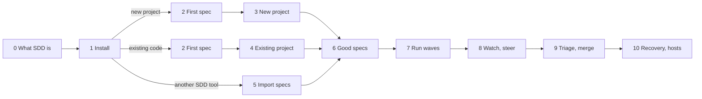

# The wavecoord course: spec-driven development with Claude Code

This course teaches spec-driven development (SDD) with wavecoord, step by step. It is for you if you have used Claude Code a little and have never written a spec for an agent.

Each lesson is a short page, a narrated video of a real Claude Code session, and an exercise. The videos have subtitles (an `.srt` file next to each MP4).

## What you will learn

- Why a written spec makes agents more reliable, and what a good one looks like.
- How to install wavecoord and check the setup.
- How to turn an idea into requirements with `/wavecoord:spec`, and requirements into tasks with `/wavecoord:wave-plan`.
- How to run several Claude Code workers at once, watch them, and merge their work safely.
- What to do when something goes wrong.

## Before you start

- Claude Code, logged in, and some practice with it (asking for a change, approving a tool call).
- `git` and `python3` 3.9 or later, on macOS or Linux.
- The GitHub CLI `gh`, logged in with `gh auth login`, and a GitHub repo you can push to. The practice repos below need no GitHub account.
- About 2 to 3 hours for the whole course; your own path may be shorter.

## Choose your path

> **Start with lessons 0 and 1. Then:**
>
> - **A new project** (no code yet): lessons 2 and 3.
> - **Existing code, no specs**: lessons 2 and 4.
> - **You already use Spec Kit, Kiro or OpenSpec**: lesson 5.
>
> **Then everyone goes on with lessons 6 to 10.**



## Lessons

| # | Lesson | You learn | Video | Time to do |
|---|---|---|---|---|
| 0 | [What SDD is and how wavecoord does it](00-what-is-sdd.md) | The problem, specs as the source of truth, the spec tree, EARS, Verify, waves, lead and workers | 4 min | 15 min |
| 1 | [Install](01-install.md) | The plugin, the CLI, `wavecoord init`, `/wavecoord:setup`, reading `wavecoord doctor` | 5 min | 20 min |
| 2 | [Your first spec](02-first-spec.md) | `/wavecoord:spec`, answering its questions, reading records, Verify, `spec check`, approving | 5 min | 25 min |
| 3 | [A new project from scratch](03-new-project.md) | The whole loop: spec, wave-plan, wave-run, triage, merge, the second wave | 10 min | 60 min |
| 4 | [An existing project with no specs](04-existing-project.md) | Specify the next feature only, paths, Verify next to existing tests | 5 min | 30 min |
| 5 | [Bring specs from Spec Kit, Kiro or OpenSpec](05-import-specs.md) | `/wavecoord:spec-import`, reviewing the draft, Verify, approving, the Spec Kit folder clash | 5 min | 30 min |
| 6 | [Writing good specs and tasks](06-good-specs.md) | Granularity, `paths`, `needs`, `conflicts_with`, the reviewer, check errors, suspect tasks | 5 min | 30 min |
| 7 | [Running waves](07-running-waves.md) | `/wavecoord:wave-run`, `wip_cap`, budgets and models, workers, the fence, protected paths, `check_cmd` | 5 min | 30 min |
| 8 | [Watching and steering](08-watching-steering.md) | The lead feed, `/wavecoord:coord-status`, `hint`, `steer`, stuck notices, `auto_steer` | 6 min | 20 min |
| 9 | [Triage and merging](09-triage-merge.md) | `/wavecoord:triage`, the refinery's checks and holds, `/wavecoord:resolve`, `/wavecoord:revise` | 7 min | 40 min |
| 10 | [Recovery and more hosts](10-recovery-hosts.md) | Lease release, `status-sync --reset`, revert and rebuild, the fence override, SSH hosts, providers | 4 min | 20 min |

## Practice repos

The videos use small demo projects with a local stand-in for GitHub, so you can repeat every lesson without an account and without touching your own code. To build one, clone wavecoord and run:

```bash
git clone https://github.com/jellologic/wavecoord && cd wavecoord
python3 scripts/course/demos/demos.py --list
python3 scripts/course/demos/demos.py brownfield /tmp/wavecoord-demo/todo --port 18741
```

| Demo | Project | For lessons |
|---|---|---|
| `fresh` | `bookmarks`: an empty repo with a README idea | 2, 3 |
| `brownfield` | `todo`: a small Python CLI with tests, no specs (`--state planned`, `flawed` or `triage` adds a spec tree) | 4, 6 to 10 |
| `speckit`, `kiro`, `openspec` | Small projects with specs in each tool's format | 5 |

Each demo has a bare `origin` under `/tmp/wavecoord-demo/origin/`. `scripts/course/demos/bin/gh` answers `gh pr create`, `view`, `merge`, `list`, `diff` and `close` for that origin. Put it first on your PATH in the terminal where you work on the demo, then set it up as in lesson 1:

```bash
export PATH="$PWD/scripts/course/demos/bin:$PATH"      # gh is now the local stand-in, in this terminal only
cd /tmp/wavecoord-demo/todo
wavecoord init --server --configure-plugin             # the config is there; init adds tokens, the server, the options
claude
```

The service that `--server` installs keeps this PATH, so it also uses the stand-in. When you are done: `wavecoord install-server --uninstall` in the demo folder, then `rm -rf /tmp/wavecoord-demo`.

Already run wavecoord for a real project? The plugin options (`coord_url`, `token`) are per Claude Code profile, so practice in a separate one (`export CLAUDE_CONFIG_DIR=~/.claude-practice`, then log in there once). If your coordinator uses port 18741, build the demo with another `--port` and start its server with `wavecoord install-server --port <that port>` instead of `init --server`.

## How the videos are made

Each video is a real, scripted Claude Code session, recorded by `scripts/course/rig.py` and assembled by `scripts/course/build.py` from the lesson scripts in `scripts/course/lessons/`. See [scripts/course/README.md](../../scripts/course/README.md) to record them again.
