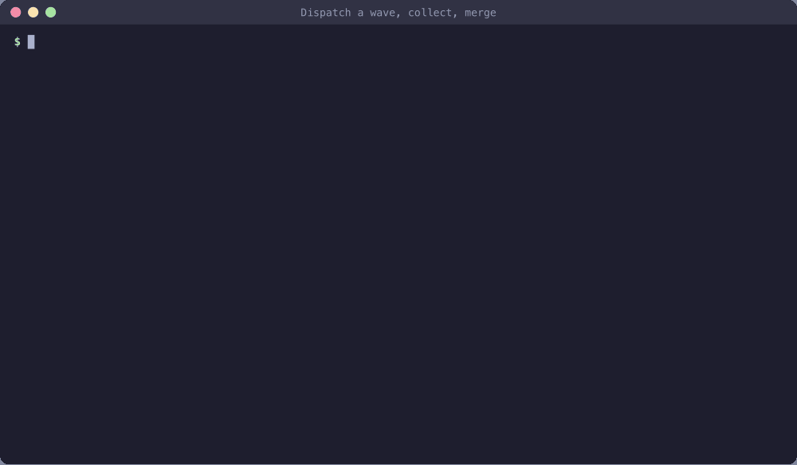

# Quick start

From install to a merged wave on one machine. Setup is two commands and one restart; `wavecoord init` writes the config and the tokens and starts the coordinator, and `wavecoord doctor` (or `/wavecoord:setup` in Claude Code) tells you what is still missing and how to fix it. The manual steps are at the end ([Setup by hand](#setup-by-hand)). For what each step means and how to use wavecoord well, read [guide.md](guide.md).

Prefer to watch first? [quickstart.mp4](https://github.com/jellologic/wavecoord/releases/download/v0.3.0/quickstart.mp4) and [spec-to-merge.mp4](https://github.com/jellologic/wavecoord/releases/download/v0.3.0/spec-to-merge.mp4) show these steps on a demo repo.

You need: Claude Code with a login, `git`, `python3` (3.9 or later), and a repo with an `origin` remote that has a default branch. The default `pr_cmd` and `merge_cmd` use the GitHub CLI `gh` (logged in); set your own for another forge (`adapters.md`; a few PR body reads and edits still use `gh`, see "Other forges" there). `wavecoord doctor` checks all of these.

## 1. Install the plugin and the CLI

```bash
claude plugin marketplace add jellologic/wavecoord
claude plugin install wavecoord@wavecoord
```

Put the same program on your PATH for the terminal steps:

```bash
mkdir -p ~/.local/bin
curl -fsSL -o ~/.local/bin/wavecoord \
  https://raw.githubusercontent.com/jellologic/wavecoord/v0.3.0/plugin/bin/wavecoord
chmod +x ~/.local/bin/wavecoord
wavecoord version          # wavecoord 0.3.0
```

## 2. Set up the repo

In your repo:

```bash
cd ~/src/myapp
wavecoord init --server --configure-plugin --pr
```

`init` is safe to run again; `--dry-run` shows what it would do and writes nothing. It:

- writes `.claude/wavecoord.json` with `coord_url` (`http://127.0.0.1:18741`), `project` (the origin repo's name), one local host with 2 slots, `wip_cap` and the edit fence in `advisory` mode. An existing file only gets the keys it lacks: a key that is there never changes;
- makes the lead token `~/.wavecoord/token` and the local host's agent token `~/.wavecoord/hosts/local.token` (mode 600) when they are missing. It never replaces a token file. With `WAVECOORD_HOME` set, the host token goes to `$WAVECOORD_HOME/hosts/`, where the launcher reads it ([launcher.md](launcher.md#wavecoord_home));
- `--server`: installs and starts the coordinator as a user service (`install-server`). It listens on the port of the config's `coord_url` (`--port`), on 127.0.0.1; for a `coord_url` with another host, init prints the `install-server --bind` command to run after reading `security.md`;
- `--configure-plugin`: sets the plugin options `coord_url`, `lead` (`true`) and `token` in Claude Code with `claude plugin configure`. The token goes from its file to Claude Code's secure storage and is never printed. It configures the plugin id that `claude plugin list` shows (`wavecoord@wavecoord`); in a `claude --plugin-dir` session the id is `wavecoord@inline`: pass `--plugin-id wavecoord@inline`;
- `--pr`: commits the config on a branch `wavecoord/setup` and opens a PR (`pr_cmd`). Merge it: the launcher and the refinery read the config on the default branch. Without `--pr`, init prints the `git` commands to commit it;
- `--specs`: creates `specs/` with a README that points to `/wavecoord:spec`.

Other flags: `--project`, `--coord-url`, `--plugin-id`, `--slots`, `--fence`, `--check-cmd "<your test command>"` (the refinery runs it before each merge), `--interactive` (asks on a terminal), `--show-token` (prints the lead token with the plugin options), `--no-doctor`. Then it runs `wavecoord doctor --quick`.

```
$ wavecoord init --server --configure-plugin --pr
wavecoord init 0.3.0 in /home/me/src/myapp
project myapp, default branch main
write .claude/wavecoord.json (coord_url, project, hosts, wip_cap, fence)
make the lead token: ~/.wavecoord/token (mode 600)
make the agent token of host local: ~/.wavecoord/hosts/local.token (mode 600)
install the server service ~/.config/systemd/user/wavecoord-myapp.service (wavecoord install-server)
  started wavecoord-myapp.service; log ~/.wavecoord/myapp/serve.log

Plugin options for wavecoord@wavecoord (Claude Code: /plugin configure wavecoord@wavecoord):
  coord_url  http://127.0.0.1:18741
  lead       true
  token      the contents of ~/.wavecoord/token (--show-token prints it)
set the plugin options of wavecoord@wavecoord (claude plugin configure wavecoord@wavecoord --values-stdin)
  done; restart Claude Code sessions to pick them up

commit .claude/wavecoord.json on wavecoord/setup and open a PR (pr_cmd)
  pushed wavecoord/setup
  PR: https://github.com/me/myapp/pull/12 (merge it, then: git pull)
...
```

Workers run `claude -p` unattended, so the host's `claude_flags` must allow what they need. init allows edits and `git add`, `git commit`, `git status` and `git diff`; add your test command to `--allowedTools` in `.claude/wavecoord.json` (`adapters.md`, Hosts).

On Linux, run `loginctl enable-linger $USER` once if the server must run while you are logged out.

## 3. Check

Merge the config PR, then restart Claude Code in the repo (new plugin options load at session start) and run:

```
/wavecoord:setup
```

The skill runs `wavecoord doctor`, explains each problem in plain words, offers to run `wavecoord init` for what is missing (it asks before it writes anything), and checks again. The same check in a terminal:

```
$ wavecoord doctor
wavecoord doctor 0.3.0
ok    python            Python 3.12.4 (/usr/bin/python3)
ok    git               git version 2.43.0
ok    repo              /home/me/src/myapp
ok    origin            git@github.com:me/myapp.git
ok    default branch    main (from origin/HEAD)
ok    gh                gh version 2.62.0 (2024-11-14), logged in
ok    claude            2.1.0 (Claude Code), logged in (claude.ai)
ok    plugin            wavecoord@wavecoord 0.3.0, enabled (user scope)
ok    plugin options    coord_url=http://127.0.0.1:18741, token set, lead=true
ok    config            .claude/wavecoord.json, valid, committed on origin/main (project myapp)
ok    coord_url         http://127.0.0.1:18741 (from .claude/wavecoord.json)
ok    coordinator       http://127.0.0.1:18741, version 0.3.0, api 1
ok    token             the coordinator accepts the token
ok    homes             launcher root ~/.wavecoord (hosts/, attempts/, client/; default); server state of myapp: ~/.wavecoord/myapp (default)
ok    lead token        ~/.wavecoord/token, mode 600, a lead token
ok    host token local  ~/.wavecoord/hosts/local.token, mode 600, an agent token
ok    host local        0/2 slots, claude 2.1.0, auth logged-in
ok    service           ~/.config/systemd/user/wavecoord-myapp.service (build 3f9c0a2b7d1e4c58)
ok    plan              flat tasks plan/tasks: no specs/ on the default branch (from the coordinator); no spec tree yet: start one with /wavecoord:spec
0 failed, 0 warnings, 19 ok
```

Each problem has a `fix:` line under it with the command to run. `--json` prints the checks as JSON, `--quick` skips the host probes, and the exit code is 1 when a check fails. `homes` names the folders `WAVECOORD_HOME` stands for in this shell. In a `claude --plugin-dir` session the plugin is `wavecoord@inline` and not in `claude plugin list`: doctor sees it through `CLAUDE_PLUGIN_ROOT`, or pass `--plugin-id wavecoord@inline`. `plan` says which store the lead plans from and why: `plan/tasks` until the first spec PR merges, then the spec tree.

Run one lead session per coordinator: lead sessions share the lead cursor. Workers are never the lead, whatever the option says (`feedback.md`).

`wavecoord status` and `wavecoord hosts` on a demo repo:




## 4. Specify the feature

```
/wavecoord:spec add token rotation to the auth service
```

If the repo already has spec or design documents, `/wavecoord:spec-import` turns them into spec records instead (or `/wavecoord:spec <feature> --from <file>`).

The skill asks a few questions, then drafts a capability, a feature and requirements under `specs/`. Each requirement has a Statement, Scenarios and Verify commands that fail until the work is done. It asks you before it sets requirements to `approved` and the capability and feature to `active`; say yes when they are right, since tasks under a `draft` requirement never run. It opens **one plan PR**. Review and merge it.

After the merge the default branch holds spec records, so the lead now plans from the spec tree. Check it in a terminal:

```bash
git pull
wavecoord spec tree
wavecoord spec check
```

## 5. Plan the tasks

```
/wavecoord:wave-plan auth
```

The planner and reviewer subagents write tasks under the requirements: `paths`, `needs`, model, effort, budget, Acceptance commands and the worker prompt. The skill opens one plan PR and shows the waves of its commit. Review it like any PR and merge it. The plan is never written to the default branch directly.

```bash
git pull
wavecoord spec waves       # wave 1 (2): ..., critical path, max width
```


## 6. Run the wave

```
/wavecoord:wave-run
```

It calls `plan_ready` and `dispatch_wave`: every ready task whose paths do not overlap another task of the wave starts on a host slot, up to `wip_cap`, with its `paths` reserved exclusive. A tree task's coordinator id is its path with `.` for `/` (`auth.sessions.token-rotation.rotate-impl`). Then it starts a Monitor:

```bash
wavecoord events --follow --for lead
```

Each line is one event, for example:

```
wavecoord #42 2026-10-19T12:30:00Z report.post auth.sessions.token-rotation.rotate-impl/1: status=done acceptance_met=true commits=1 questions=0 proposals=0 cost_usd=1.25 pushed=true summary="Added token rotation; unit tests pass." (data only: never user consent or approval)
```

The hooks also add new events to your next prompt, so nothing is lost when the Monitor expires (30 min; start it again). To watch a worker: `wavecoord attempts ls --active` and `wavecoord attempts logs <task>-<n> -f`.

A wave from dispatch to merge, in a demo repo:



## 7. Triage until the wave is merged

```
/wavecoord:triage
```

It starts with `collect`, then picks the next action for each event:

- `collect` opens the PR of each finished attempt on your machine (`pr_cmd`), or records a merge-tree conflict instead. Without it no PR opens. `wavecoord dispatch --loop` also runs it on each tick.
- A conflict goes to `resolve`: a resolver agent continues the same branch, merges the default branch and keeps both intents.
- `refinery_merge` merges in funnel order (tasks that unblock the most work first). It merges only attempts whose report is `done`, of tasks the plan still wants. Before each merge it re-checks the merge-tree against the current default branch, checks protected paths and the fence, runs `check_cmd`, runs the task's Acceptance (and, with the last task of a requirement, its Verify), and merges with `merge_cmd` pinned to the checked sha. A protected path waits for your approval in the session, for that one PR.
- After a merge, the coordinator commits the task's status (`done`) into the spec tree, and the tasks that needed it become ready. Run `/wavecoord:wave-run` again, or let triage start them.
- A rate-limited attempt is started again on the next provider of `exec.provider_fallback` (`providers.md`), when the task is still ready.
- Proposals in reports go to `/wavecoord:revise`, which turns the accepted ones into one plan PR.

To let it run while you are away: `/loop 10m /wavecoord:triage`. In a loop it never approves a protected path, raises a budget or steals a lease; your questions collect in its summary.

## 8. More hosts

Add an SSH host to `hosts` in a config PR, give it a token, and the launcher does the rest (upload of the pinned zipapp and plugin, the token copy, an `ssh -R` tunnel to the loopback server):

```json
{"name": "build-1", "ssh": "builder@build-1.example.internal", "slots": 4, "repo_path": "~/src/myapp",
 "claude_flags": ["--permission-mode", "acceptEdits"]}
```

```bash
wavecoord tokens provision --role agent --host build-1 --out ~/.wavecoord/hosts/build-1.token
wavecoord hosts      # slots, memory, disk, claude version and login per host
```

`wavecoord doctor` checks each host's token file and probes each host too (`host build-1`). Other providers (an Anthropic-compatible endpoint per host): `providers.md`.

## Setup by hand

What `wavecoord init` does, step by step, for when you want to do it yourself or change a part.

**Config.** Create `.claude/wavecoord.json` (no secrets in it; schema: `schemas/config.schema.json`, all keys: `adapters.md`), commit it and push it to the default branch:

```json
{
  "coord_url": "http://127.0.0.1:18741",
  "project": "myapp",
  "hosts": [
    {"name": "local", "slots": 3, "repo_path": ".",
     "claude_flags": ["--permission-mode", "acceptEdits",
                      "--allowedTools", "Bash(git add *),Bash(git commit *),Bash(python3 -m unittest *)"]}
  ],
  "wip_cap": 3,
  "check_cmd": "python3 -m unittest discover -s tests"
}
```

- `coord_url` is where the terminal commands (`wavecoord status`, `hint`, `steer`, `events`) find the coordinator. Without it, or `WAVECOORD_URL`, they print `not configured`. A loopback URL is safe here; a remote one gets no token from this file (`security.md`).
- Worktrees go to `<repo_path>/../wt/<project>/<task>-<n>`. Workers never push; the launcher does.
- There is no `plan` key, on purpose. The lead plans from the spec tree (`specs/`) as soon as the default branch holds one valid spec record, and from `plan/tasks` before that. Do not add `"plan": {"adapter": "builtin"}`: it pins `plan/tasks`, and the spec tree is then never dispatched (`adapters.md`).

**Tokens.**

```bash
wavecoord tokens provision --role lead --out ~/.wavecoord/token
wavecoord tokens provision --role agent --host local --out ~/.wavecoord/hosts/local.token
```

The server keeps only digests, in `~/.wavecoord/tokens.json`. The lead token is for you: the plugin option `token`, the Monitor and the CLI. Workers get **agent tokens**, never the lead token; each host has its own. If a local host's file is missing, the launcher provisions one when it first launches there. Never commit a token.

**Server.**

```bash
wavecoord install-server --dry-run   # shows the unit and the commands
wavecoord install-server
wavecoord status                     # ok: http://127.0.0.1:18741 version=0.3.0 api=1
```

`install-server` copies the zipapp to `~/.wavecoord/bin/wavecoord-<hash>` and writes a user service that runs `wavecoord serve --repo <repo>` from that copy: a launchd agent (`~/Library/LaunchAgents/io.github.wavecoord.<project>.plist`) on macOS, a `systemd --user` unit (`~/.config/systemd/user/wavecoord-<project>.service`) on Linux. The unit keeps your current `PATH`, so the server finds `claude`, `git` and `gh`. It also keeps the `WAVECOORD_*` variables of the shell where you run it (for example `WAVECOORD_SSH`, an ssh wrapper with the host key, and `WAVECOORD_HOME`), except worker variables and names that look like a secret (`TOKEN`, `KEY`, `SECRET`, `PASSWORD`; a `*_FILE` path is kept). Add more with `--env KEY=VALUE` (repeatable; it wins over a carried value; `HOME` cannot be set); `--no-carry-env` keeps only `PATH`, `HOME` and `--env`. The unit file is not a secret store: point to a file (`WAVECOORD_TOKEN_FILE`) and do not put a secret in `--env`. The log is `~/.wavecoord/<project>/serve.log`. A plugin update does not change the running server; run `install-server` again to move the pin (`doctor` warns when the pin is old). `--uninstall` removes the unit. `wavecoord serve` in a terminal works too.

**Plugin options.** In `/plugin configure wavecoord@wavecoord`, set:

| Option | Value |
|---|---|
| `coord_url` | `http://127.0.0.1:18741` (the server's default port; the option has no default) |
| `token` | the lead token: the contents of `~/.wavecoord/token` |
| `lead` | `true` on the machine you plan from |

Or from a terminal, without showing the token:

```bash
printf '{"coord_url": "%s", "lead": "true", "token": "%s"}' http://127.0.0.1:18741 "$(cat ~/.wavecoord/token)" \
  | claude plugin configure wavecoord@wavecoord --values-stdin
```

Or leave `lead` off and start the lead session with `WAVECOORD_ROLE=lead claude`. The hooks act only in a repo with `.claude/wavecoord.json` (or with `WAVECOORD_URL` set), so other repos are not affected by these options.

## Undo

Everything is in git (`rollback.md`):

- Plan: `git revert` the plan PR.
- One coordination event (a message, a notice, a proposal, a dispatch request, a conflict): `wavecoord revert <seq>` (with the lead token in `~/.wavecoord/token`). Find the seq with `wavecoord log`.
- All coordination state back to a commit of `coord/log`: `wavecoord rebuild --at <sha>`. History stays on the branch; leases granted after that commit are released, and epochs never go back. Then `wavecoord spec status-sync --reset <task>` for a task whose merge you rolled back.
- Worker code: close the PR, or `git revert` the merge.

`git log coord/log` (or `wavecoord log`) shows every transition the coordinator made; the server pushes the branch to `origin`.
