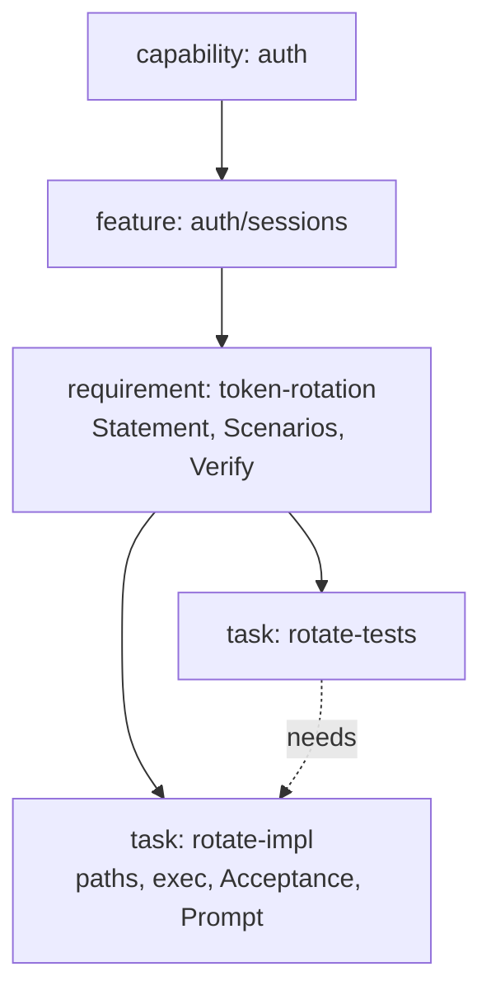
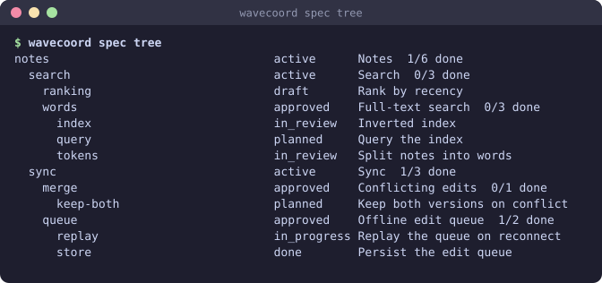
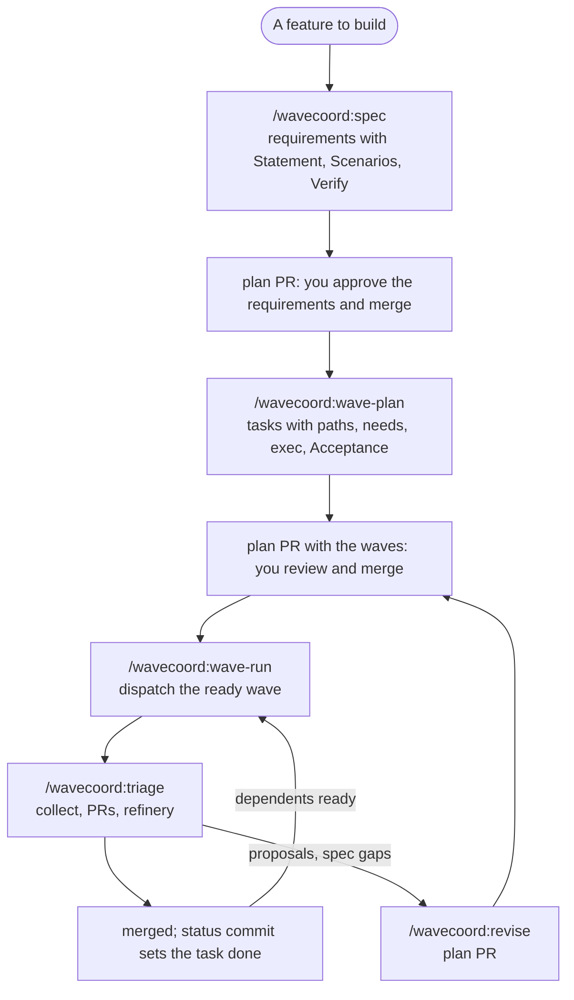
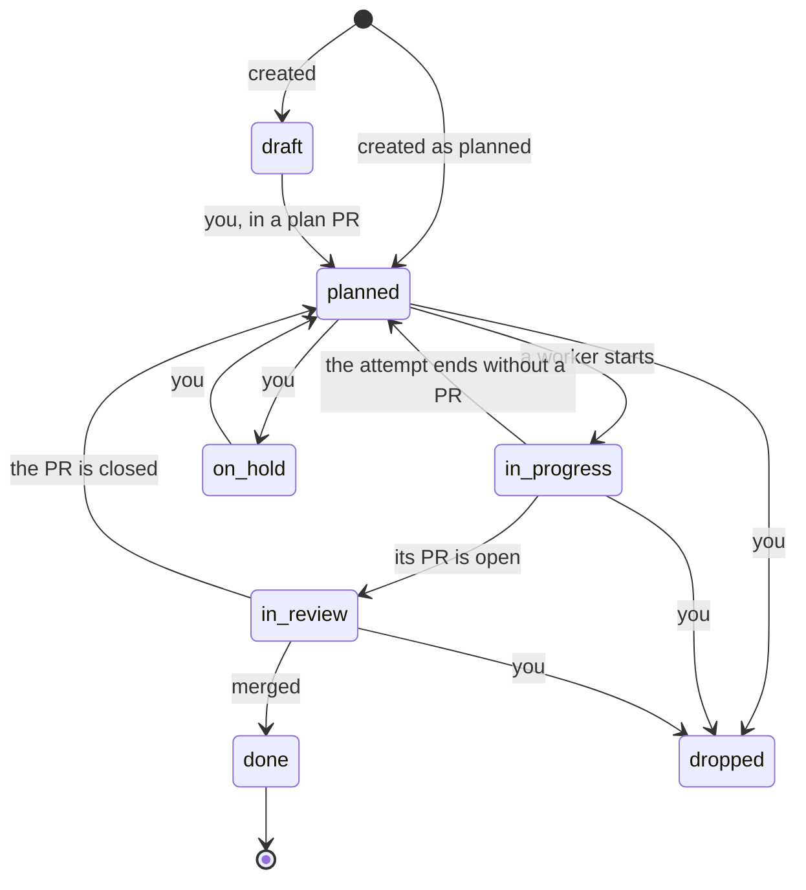

# Specs

Status: available (0.2.0). The design and its rules are in `design/spec-layer.md`.

The spec tree is your plan, from capability to task, as Markdown files in your repo. People read and review them like code; wavecoord treats them as a database: each file is one typed record, and `wavecoord spec check` proves that the tree is consistent.

## The tree

```
specs/                                   another folder: "spec": {"dir": "..."} in .claude/wavecoord.json
  auth/                                  capability
    _node.md
    sessions/                            feature
      _node.md
      token-rotation/                    requirement
        _node.md
        tasks/
          rotate-impl.md                 task
          rotate-tests.md                task
```

- The path is the ID: `auth/sessions/token-rotation/rotate-impl`.
- The folder is the parent. Names are lowercase letters, digits and `-`.
- There is no index file. `wavecoord spec tree` is the index.





## From idea to merged code



[guide.md](guide.md) walks through this loop with what you type and what you see at each step.

## What every node says

```markdown
---
status: approved
kind: requirement
schema: 1
title: Token rotation on expiry
needs:
  - auth/sessions/session-store
inputs:
  - id: auth.session-store.api
    kind: interface
    from: auth/sessions/session-store
outputs:
  - id: auth.rotation.service
    kind: interface
    contract: rotate(refresh_token) -> TokenPair; the old refresh token is revoked
---

## Statement
When an access token is within 60 s of expiry, the auth service shall issue a new token and revoke the old one.

## Scenarios
### Near-expiry token is refreshed
- Given a session whose token expires in 30 s
- When the client calls refresh
- Then a new token pair is returned

## Verify
- `python -m unittest tests.test_rotate`
```

- **`outputs`**: what the node hands over, each with a kind (`file`, `interface`, `api`, `schema`, `data`, `config`, `doc`, `event`) and, for an interface, a one-line contract.
- **`inputs`**: what the node takes in, and `from` which node, or `external: true`.
- **`needs`**: what must be done first. A node can need a task or a whole feature; a node also waits for whatever its parents need. A need on a node counts its tasks that are not dropped. A need that does not resolve, on a record that is invalid, or on a node with no tasks yet is never met, so nothing starts early.
- **`conflicts_with`**: what must not run at the same time for a reason the tree cannot see, such as a shared database.

A task adds what a worker needs: `paths` it may change, `exec` (model, budget, turns), Context, Risks, Acceptance and Prompt, as in today's task specs.

## What `check` proves

- Every output a requirement, feature or capability promises is produced by exactly one task under it. Before any task is planned under it, this is a warning, so you can write requirements first and plan tasks later.
- Every input comes from a node the consumer reaches through `needs`, or is external.
- No two tasks produce the same thing, and file outputs are inside the task's `paths`. A dropped task produces nothing.
- `needs` and `supersedes` have no cycles, and every reference resolves.
- Every record fits its schema: its kind matches its path, it has no unknown keys, and lists are lists. A record that does not is reported and left out, and what needs it waits.
- `paths` are written plainly (`src/a.py`, not `./src/a.py` or `src//a.py`).
- The files are in canonical form. `fmt` never drops data: it refuses a record it cannot write back whole and leaves the file as it is.
- A symlink under `specs/` is an error: records are regular files.

## What can run at the same time

You never write it. `wavecoord spec waves` computes it: two tasks can run together when neither needs the other, their paths do not overlap, and they do not conflict. It prints the waves, the critical path and the widest wave. Wave 1 is the tasks that can run now (or are running); a task that cannot run yet for another reason (its status, an unapproved requirement) is left out of the waves and listed under `held` with the reason (`wavecoord spec ready` gives the reason too). If two tasks could run together but write the same file, `check` tells you to add a `needs` or split the file.

## Status

| Node | Status | Set by |
|---|---|---|
| capability, feature | `draft`, `active`, `deprecated` | you, in a plan PR |
| requirement | `draft`, `approved`, `deprecated` | you, in a plan PR |
| task | `draft`, `planned`, `on_hold`, `dropped` | you, in a plan PR |
| task | `in_progress`, `in_review`, `done` | wavecoord |



wavecoord commits task status to your default branch as work moves: `in_progress` when a worker starts, `in_review` when its PR is open, `done` when it merges, and back to `planned` when an attempt ends without a merge. The coordinator reconciles: at each flush (every `spec.status_flush_s`, 60 s, and at once after a merge) it compares the files with what it knows and commits only the `status:` lines that differ, as `wavecoord: status (<n> tasks)` with one `Wavecoord-Status: <task> <from> <to>` line per change. It reads the files at one commit of the default branch and builds the status commit on that same commit, so it changes only `status:` lines. It writes only over `planned`, `in_progress` and `in_review`: it never changes `draft`, `on_hold` or `dropped`, and never undoes `done`. A plan change cannot set `in_progress`, `in_review` or `done`, cannot change a `done` task's status, and can only drop a task that is `in_progress` or `in_review`: the op API refuses it, and `wavecoord spec check --base origin/main` reports it for a hand edit. `in_review` needs an open PR; a finished attempt without one stays `in_progress`. `status` is always the first line of the frontmatter, so these commits do not conflict with your plan PRs. `ready`, `blocked` and progress are computed, never written.

If you hold, drop or draft a task while its attempt runs, your status stays in the file and the task is not dispatched again. The attempt is not stopped; use `wavecoord steer <task> stop`. `status-sync` lists such tasks under `held`.

If a merge is rolled back with `wavecoord rebuild --at`, the file still says `done`. `wavecoord spec status-sync --reset <task>` (or `spec_status_sync` with `reset`) sets it back to `planned` when the coordinator has no merged attempt for it. A revert of the merge commit leaves the merged attempt in the coordinator, so the task stays `done`: plan a new task to redo the work.

A push that lost a race is retried after a fetch. When the default branch refuses the push (branch protection), the same commit goes to the branch `wavecoord/status`, one PR "wavecoord: status" carries it, and `merge_cmd` merges it with the same placeholders and `WAVECOORD_*` variables as a task PR. wavecoord force-pushes this branch (it is its own), and rebuilds it only when the changes or the default branch move, so its checks can finish. A closed status PR is replaced by a new one. After a restart the writer finds its open status PR again (by `pr_state_cmd` with the branch, or the answer of `pr_cmd`) instead of opening a second one. Any other push failure, or a status PR that cannot be merged, is logged as `spec.status_blocked`, once per reason, under the actor `status-writer` (so it reaches the lead's feed: `feedback.md`), and the status stays live in the coordinator. A status flush never fails `dispatch`, `collect` or a merge. `wavecoord spec status-sync` (or the `spec_status_sync` tool) flushes at once.

Status commits and the commits of `spec_edit` and `plan_edit` do not run your git hooks (`core.hooksPath=/dev/null`, `--no-verify`), so a commit-message or pre-push hook does not refuse them. Check them in CI instead.

Each task records `basis`, a fingerprint of its requirement. When the requirement's statement, scenarios, checks or contracts change, the task becomes suspect. `wavecoord spec suspect` lists such tasks; after review, `wavecoord spec rebase-basis <task>` clears it.

## What wavecoord enforces

- A task runs only when its requirement is approved and its parents are active. Turn this off with `"require_approved": false`.
- The worker's prompt holds its requirement, its inputs and outputs with their contracts, and the Verify commands.
- A worker's PR may not change `specs/` (or your `spec.dir`, in any letter case). Workers propose spec changes in their report, and `/wavecoord:revise` turns the ones you accept into a plan PR. This rule applies only when the repo uses the spec tree: `plan.adapter` is `specs`, or there is no `plan` key and `spec.dir` has files on the default branch. With `"plan": {"adapter": "builtin"}`, a `specs/` folder of your own (an OpenAPI file, say) is just code.
- The merge re-runs the task's Acceptance, taken from your default branch, and, with the last open task of a requirement, the requirement's Verify too (a `dropped` or `on_hold` sibling is not open). They run on the merge of your default branch and the PR, so sibling work merged earlier is there, and after the fence check. They get a scrubbed environment: add names with `"verify_env": ["CARGO_HOME"]` (`security.md`). A failure blocks (`verify_failed`). A task or requirement record that is missing or does not parse blocks too (`verify_unavailable`). Turn this off with `"verify_at_merge": false` in the config on your default branch; the lead's working tree copy does not count.
- If you drop the last open task of a requirement after its siblings merged, no merge runs the requirement's Verify. Run it yourself, or in CI.
- The refinery merges only a PR whose report is `done`, of a task that is not `dropped`, `on_hold` or `draft` on your default branch. A PR of a task you held or dropped waits (`held`): close it, or restore the task's status in a plan PR.
- A task id names its coordinator history (attempts, merges). `spec_edit` refuses a new task under the id of a deleted task that the coordinator merged, runs or has in review: it would start as done or running. A hand edit in a plan PR is not checked against the coordinator, so pick a new name there too.
- `spec.dir` is read as a clean relative path (`./specs/` is `specs`); the schema rejects `.`, `..` and `//` in it.
- The PR body of a task ends with the trailers `Spec-Task:` and `Spec-Basis:`, so a squash merge carries them into `git log`.
- When your default branch is protected, status commits go through one `wavecoord: status` PR instead.

## Keeping merges clean

Two branches that change different nodes never conflict. To keep it that way:

- one node per file;
- one item per line, kept sorted;
- one sentence per line in prose;
- no counts, summaries or "done" lists in the files;
- let the tools write, or run `wavecoord spec fmt`;
- move nodes with `wavecoord spec mv`, which keeps the old ID as an alias.

Put `wavecoord spec check --base origin/main && wavecoord spec fmt --check` in CI. Two changes pass that check although they set statuses the coordinator writes:

- the status PR (`wavecoord/status`): its commit changes `status:` lines only, between `planned`, `in_progress`, `in_review` and `done`, and names each change in a `Wavecoord-Status:` line of its message. A hand edit has no such line and is reported. Anyone who can push can write that line, so treat the status branch like your other bot branches in review rules;
- the output of `wavecoord spec migrate-plan`: a new task whose `aliases` hold a flat plan id (no `/`) keeps the status the coordinator gave it.

## Commands

```
wavecoord spec tree [node]                       the tree with status and progress
wavecoord spec waves [node]                      what can run together
wavecoord spec query 'kind=task status=planned paths~src/auth/*'
wavecoord spec show <id> [--json]
wavecoord spec trace <id>                        parents, children, needs, producers, consumers, decisions
wavecoord spec new auth/sessions/token-rotation --kind requirement --title ... --section Statement=...
wavecoord spec status <task> on_hold
wavecoord spec status-sync [--reset <task>]      write status now; --reset undoes a rolled-back done
wavecoord spec mv <old id> <new id>                (moving back to the old id is allowed)
wavecoord spec delete <id>                       refused while referenced; --force also deletes children
wavecoord spec migrate-plan --dry-run            move plan/tasks into the tree
wavecoord spec import --from kiro --dry-run      import Spec Kit, Kiro or OpenSpec files (import.md)
```

## Coming from another tool

A project that uses GitHub Spec Kit, Amazon Kiro or OpenSpec can move its specs into the tree with `wavecoord spec import`, or in the lead session with `/wavecoord:spec-import`, which also reads PRDs and ADRs. The imported records are drafts that name their source files. [import.md](import.md) has the mapping for each tool and what it leaves for you.

## Moving a flat plan

`wavecoord spec migrate-plan` writes each `plan/tasks/<id>.md` as `legacy/unsorted/unsorted/tasks/<name>` in the working tree:

- It asks the coordinator for each task's state: merged becomes `done`, running `in_progress`, a PR in review `in_review`. Pass `--states FILE` instead, or `--no-coord` when no task ever ran; without one of them it stops when the coordinator is unreachable.
- `blocked` becomes `on_hold`; `done` and `dropped` stay.
- The old id stays in `aliases`, so the coordinator's state under it still applies.
- Open tasks whose paths overlap get `conflicts_with`, so they still run one at a time.
- The legacy requirement is `approved`, and its capability and feature `active`, so the tasks run as before. Review that in the plan PR.

Then commit `specs/` with the removal of `plan/tasks`, open a plan PR and merge it. Move the tasks under real requirements with `wavecoord spec mv`.

Migrate before the first spec records land on your default branch. With no `plan` key, the merge of the first record switches the lead from `plan/tasks` to the tree; flat tasks that are not in the tree then block at merge (`verify_unavailable`) and are no longer dispatched. `spec_edit` warns with `switch:` when its PR would do that.

Every read takes `--json`, and every write takes `--dry-run`. In the lead session, `/wavecoord:spec` builds the tree with you and opens one plan PR, and `/wavecoord:wave-plan` plans tasks under requirements.

## In the lead session

The lead plans from the spec tree when `plan.adapter` is `specs`, or when no adapter is set and `spec.dir` on the default branch holds at least one valid record. Stray files there (an `openapi.yaml`, a README) do not count, and the lead never reads the tree from its working tree: commit and merge the tree first. The `config` tool shows which store is in use. When it cannot read the default branch, the lead refuses (`unavailable`) instead of planning from `plan/tasks`. With `plan.adapter` set to `builtin` or `commands`, the spec tools still read the tree but nothing dispatches from it: `spec_tree` and `spec_waves` say so in `plan_note`.

The lead's tools read the tree on the default branch: `spec_tree`, `spec_get`, `spec_query`, `spec_waves`, `spec_trace` and `spec_check`. `spec_edit` takes the same ops as `wavecoord spec apply`, writes them as one commit on a new `plan/<n>` branch (moves as `git mv`), and opens a PR; pass its `branch` to the next `spec_edit` to add to the same PR, whose body it then rewrites for the whole branch (files, check, warnings; with `gh pr edit`, so a `pr_cmd` without `gh` gets `pr_body_error`). To preview ops against what `spec_edit` reads, run `wavecoord spec apply - --dry-run --ref origin/main` (or `--ref origin/plan/<n>`); `--ref` works only with `--dry-run`.

`spec_waves` and `spec_trace` name tasks by their path. The coordinator names a task by its path with `.` for `/`: `auth/sessions/token-rotation/rotate-impl` is task `auth.sessions.token-rotation.rotate-impl` in leases, attempts, branches (`wave/<task>-<n>`) and the PR's `Task:` line. `check` keeps that name within 64 characters. After `mv`, the old id stays in `aliases`, and the coordinator's leases, attempts and merges under it still belong to the task: a moved task keeps its status and is not dispatched again. `plan_get` and `dispatch` take the tree id or an alias too.

A task is not ready while a task it `conflicts_with` runs or is in review, and `dispatch_wave` never starts both. A task left `in_progress` or `in_review` in the files with no live attempt is ready again, even before the status commit that resets it lands.

A worker's prompt holds its requirement's statement and scenarios, its inputs and outputs with their contracts, and the requirement's Verify commands under "Also run".
