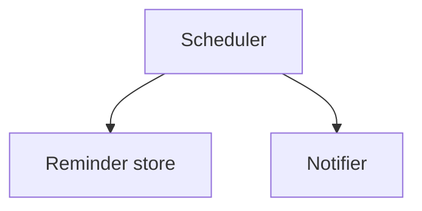

# Design Document

## Overview

A scheduler thread reads due reminders from SQLite once a minute and hands them to the notifier.

## Architecture

## Components and Interfaces

- `ReminderStore.add(task_id, at)` stores a reminder.
- `Notifier.send(user_id, text)` delivers a notification.

## Testing Strategy

Unit tests use a fake clock.
